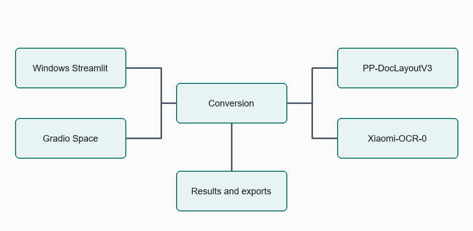

# DocFlow Xiaomi OCR

Separate native Windows Streamlit and Hugging Face Gradio apps. Both use Xiaomi-OCR-0 recognition and PaddlePaddle/PP-DocLayoutV3_safetensors layout detection.

GitHub repository: [pypi-ahmad/DocFlow-Xiaomi-OCR-0](https://github.com/pypi-ahmad/DocFlow-Xiaomi-OCR-0).

Read [how the models work](docs/models.md) for their official references and how DocFlow combines them.

## Setup and use on Windows

Install Git, Python 3.12 and [uv](https://docs.astral.sh/uv/getting-started/installation/). You also need an NVIDIA GPU with a compatible driver. No Docker or WSL is required.

Clone the repository and run setup in PowerShell:

```powershell
git clone https://github.com/pypi-ahmad/DocFlow-Xiaomi-OCR-0.git
cd DocFlow-Xiaomi-OCR-0
uv sync --python 3.12
uv run python -m scripts.setup-models
.\launch.cmd
```

Setup downloads pinned model snapshots. Normal launches use local files only. Open http://127.0.0.1:8472. Models load on first conversion; saved results can be opened without loading models.

Upload a document, select its pages and start conversion. Review the results in the output tabs, then download individual outputs or the document ZIP. To launch again later, open PowerShell in the cloned folder and run `.\launch.cmd`.

PDF, PNG, JPEG, GIF, TIFF and WebP inputs support page selection, batches, annotations, Markdown, HTML, JSON, chunks and ZIP exports. Chat, classification and business-field extraction are excluded.

The local workbench follows DocLayout's conversion workflow: upload and choose pages in the sidebar, preview before parsing, then inspect Input preview, Markdown, HTML, Annotated, JSON and Chunks tabs. Choose a batch result or open a saved conversion in the sidebar. Each output tab has its own download; the sidebar provides the document ZIP. Navigation and previews do not load models. Clearing the view preserves saved files.

## Separate Space

Deployment target: `pypi-ahmad/DocFlow-Xiaomi-OCR-0`. The previous Nemotron Space remains separate. The new Space requires ZeroGPU hardware. Upload application files, requirements and this README; exclude environments, model caches, credentials and conversion results.

The Space accepts five files and five selected pages total, 50 MiB per file, and 40 megapixels per image frame. GPU calls have a 120-second limit; dense pages may require smaller jobs. Results are temporary and session-isolated.

## Validation

```powershell
uv run python -m pytest -q
uv run ty check docflow
```

See the [user guide](docs/user-guide.md) for conversion and troubleshooting, the [developer guide](docs/developer-guide.md) for architecture and deployment, and the [migration validation](docs/xiaomi-migration-validation.md) for dated checks. Space creation was blocked by the account limit of two free ZeroGPU Spaces; the new Space has not been published.

## Architecture



[View the accessible diagram](docs/diagrams/architecture.html).
